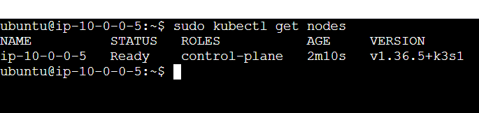
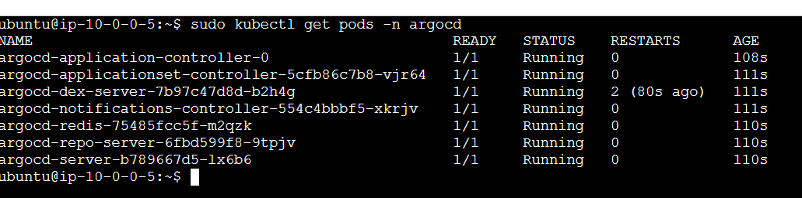
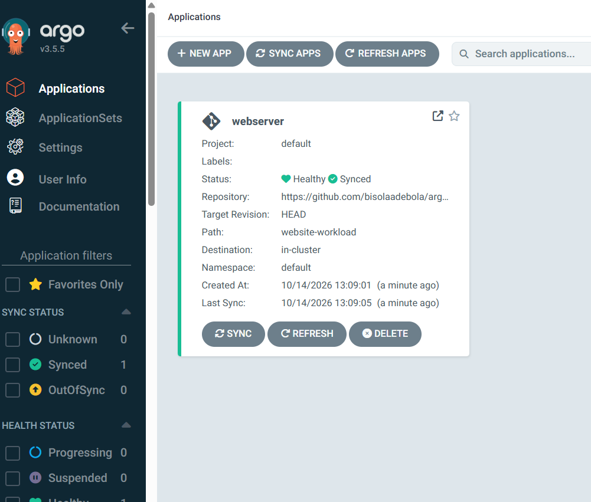
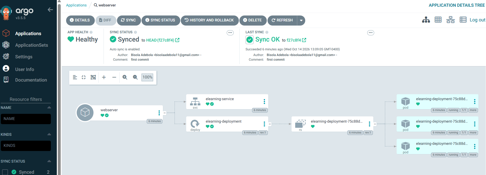

# Argo CD GitOps Deployment on AWS EC2

A hands-on Cloud and DevOps project demonstrating Kubernetes cluster setup on AWS EC2 and GitOps-based application management using Argo CD and GitHub.

## Project Overview

This project explores how GitOps can simplify Kubernetes application management by using Git as the source of truth for application configuration.

I provisioned an AWS EC2 instance, configured Kubernetes on the instance acting as both the control-plane and worker node, installed Argo CD, and connected it to a GitHub repository containing Kubernetes manifests.

Argo CD was then used to monitor the repository, synchronize the desired application configuration, and manage Kubernetes resources through its web interface.

## Project Objectives

- Provision and configure an AWS EC2 instance for Kubernetes.
- Install and configure Kubernetes on a single-node cluster.
- Deploy Argo CD into the Kubernetes cluster.
- Connect Argo CD to a GitHub repository containing Kubernetes manifests.
- Deploy and manage application resources through Argo CD.
- Verify application health and synchronization status.
- Understand GitOps principles and declarative application management.

## Architecture

The project follows this workflow:

1. **AWS EC2:** Provides the compute environment for the Kubernetes cluster.
2. **Kubernetes:** Runs the cluster and manages application workloads.
3. **GitHub:** Stores the Kubernetes manifests that define the desired application state.
4. **Argo CD:** Monitors the configured Git repository and compares the desired state with the live cluster state.
5. **Kubernetes resources:** Argo CD manages the application's Deployment, ReplicaSet, Service, and Pods.

### Architecture Flow

```text
Developer
    |
    | Commit and push Kubernetes manifests
    v
GitHub Repository
    |
    | Argo CD monitors configured repository path
    v
Argo CD on Kubernetes
    |
    | Reconcile / synchronize resources
    v
Kubernetes Cluster on AWS EC2
    |
    +---- Deployment
    +---- ReplicaSet
    +---- Service
    +---- Application Pods
```

## Technologies Used

- **AWS EC2** – Cloud compute infrastructure
- **Linux** – Server administration and command-line operations
- **Kubernetes** – Container orchestration and workload management
- **Argo CD** – GitOps continuous delivery and Kubernetes application management
- **Git and GitHub** – Version control and declarative configuration storage
- **YAML** – Kubernetes resource definitions

## Implementation Steps

### 1. Provision AWS Infrastructure

Created an EC2 instance to host the Kubernetes environment and prepared the server for installation and configuration.

### 2. Install Kubernetes

Installed and configured Kubernetes on the EC2 instance, which served as both the control-plane and worker node for this single-node cluster.

### 3. Install Argo CD

Deployed Argo CD into the Kubernetes cluster and accessed its web interface to manage applications.

### 4. Integrate GitHub

Connected Argo CD to a GitHub repository containing Kubernetes manifests and configured the application source path.

### 5. Deploy and Manage the Application

Configured the `webserver` Argo CD application to use the `website-workload` repository path and deploy resources to the in-cluster Kubernetes destination.

### 6. Verify Synchronization and Health

Used the Argo CD dashboard and application resource tree to verify successful synchronization and healthy application resources.

The application resource tree displayed a Service, Deployment, ReplicaSet, and three running Pods.

## Project Screenshots

Screenshots documenting the infrastructure, installation, GitOps integration, and deployment verification are available in the `screenshots/` directory.


### 1. Kubernetes Cluster



### 2. Argo CD Installation



### 3. Argo CD Applications Dashboard



### 4. Argo CD Application Resource Tree




## Key Outcomes

- Set up a Kubernetes environment on AWS EC2.
- Installed Argo CD and accessed its web interface.
- Integrated Argo CD with a GitHub repository.
- Managed Kubernetes application resources through Argo CD.
- Verified a Healthy and Synced application state.
- Gained hands-on experience with GitOps workflows and declarative configuration management.

## Key Learnings

- Kubernetes control-plane and worker-node concepts.
- Deploying and managing applications using Kubernetes manifests.
- Integrating Git repositories with Argo CD.
- Understanding desired state versus live cluster state.
- Using Argo CD synchronization and health indicators.
- Understanding how GitOps supports repeatable and auditable deployments.

## Future Improvements

- Demonstrate a Git change triggering an application update.
- Configure and test automated synchronization if not already verified.
- Explore Argo CD Application resources managed declaratively through Git.
- Add HTTPS-secured access and appropriate authentication controls.
- Explore multi-node Kubernetes deployments and production-oriented security.

## Documentation

- [Architecture](docs/architecture.md)
- [Deployment Guide](docs/deployment.md)
- [Lessons Learned](docs/lessons-learned.md)

## Author

**Bisola Adebola**

Cloud and DevOps Engineering Portfolio Project